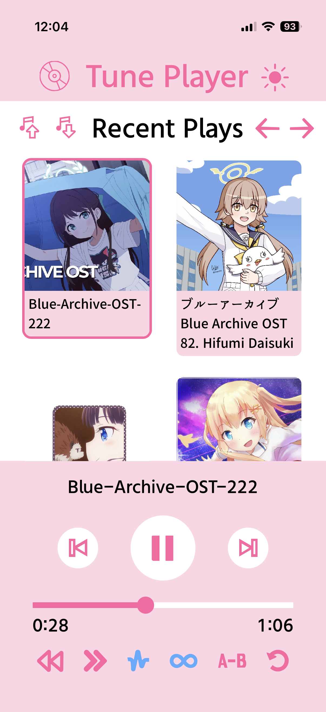

## Tune Player App
   

The mobile app for Tune Player! Because I needed to have it on phone as well. 

### Features:
- Play audio (MP3, WAV, OGG, FLAC) and MIDI files
- Reverse playback
- Speed adjustment (can either preserve or affect the pitch)
- Pitch shifting (and LFO pitch effect)
- Looping from point A to point B
- Render and download audio/midi with effects

Filters and effects might be added soon (I don't know where to fit them tbh)

### Desktop App

- [Tune Player](https://github.com/Moebytes/Tune-Player)